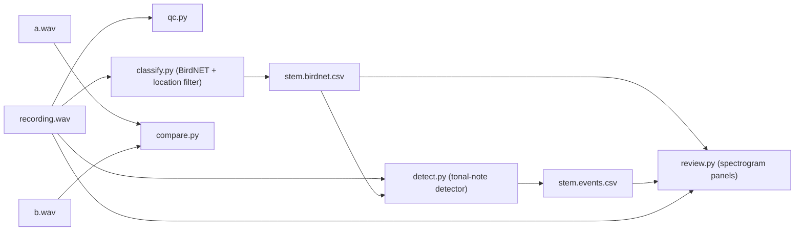

# birdcode
bird sound wav analysis. mostly for fun. may include frog and insect sounds tbd
# birdlog

Scripts for analysing phone recordings of birds: is the recording any good, what
is in it, and how much of what is in it did the classifier actually recognise.
Grown out of a windowsill-and-fluffy-bag setup in inner Sydney; nothing here
assumes anything better than a phone with its processing turned off.



## Install

```bash
python -m venv .venv && source .venv/bin/activate
pip install -r requirements.txt
```

`requirements.txt` installs the `birdnet` package with the TensorFlow extra,
which is what the official geo (location) model needs. If TensorFlow is a
problem on your machine, `pip install birdnet ai-edge-litert onnxruntime`
runs the acoustic model without it (`--backend litert`, the default) and the
geo model through the ONNX route described under classify.

CPU is enough. BirdNET 2.4 runs several times faster than real time on a laptop.

### Running in a Claude Code cloud environment

Cloud sessions clone the repo from GitHub and run in a VM with Python, pip and
uv pre-installed, 16 GB RAM and 30 GB disk. Two things need configuring in the
environment (the cloud icon above the message box at claude.ai/code, or in the
Claude app's Code tab):

- **Network access**: the default *Trusted* list covers PyPI and GitHub but not
  `zenodo.org`, which is where the `birdnet` package fetches the acoustic model
  weights. Set the environment to *Custom*, tick "also include default list of
  common package managers", and add `zenodo.org`. The geo model's taxonomy comes
  from the birdnet-team/geomodel GitHub repository, which the session's GitHub
  proxy may refuse (it scopes GitHub requests to repositories attached to the
  session); the committed species list sidesteps that, so use `--species-file`
  in the cloud.
- **Setup script** (runs once, then the filesystem is snapshotted and reused as
  long as it finishes within about five minutes):

  ```bash
  pip install numpy scipy pandas matplotlib soundfile birdnet ai-edge-litert onnxruntime
  python -c "import birdnet; birdnet.load('acoustic', '2.4', 'tf', library='litert')" || true
  ```

  The second line pre-downloads the model so it lives in the snapshot. Leave
  TensorFlow out in the cloud: the install is large and the only thing it buys
  is the package's own geo route, which the species file replaces.

Recordings have to be in the repo for a cloud session to see them (a `recordings/`
folder of WAVs; GitHub refuses files over 100 MB and a 2-minute 48 kHz mono WAV is
about 11 MB). Outputs written to `out/` during a session persist only if
committed; commit the CSVs, not the PNGs.

## The scripts

Each is standalone, takes `--help`, and runs under `python -I`.

### qc.py — did the setup work?

```bash
python qc.py rec.wav [more.wav ...] [--json report.json]
```

Reports format and levels; the 1 s RMS envelope (an unprocessed recording of
steady ambient sits within about 1 dB for minutes; AGC pumps it); an AGC
heuristic comparing the quiet floor before and after loud events; mains and
mechanical hum peaks; the 20–120 Hz wind band (median, std, 99th percentile:
gusts show in the tail); an electronic-floor estimate from 16 kHz to Nyquist,
and how far the 4–8 kHz ambient sits above it; a third-octave spectrum; and
the steepest step between adjacent bands above 4 kHz, which separates a
codec or voice-mode low-pass (a cliff) from ordinary mic and ambient roll-off
(a slope).

The AGC heuristic needs an isolated loud event in a steady ambient to mean
anything. A clap at arm's length is a better test than whatever happened to be
in the recording.

### classify.py — BirdNET with a location filter

```bash
python classify.py recordings/ --lat -33.90 --lon 151.19 --out out/
python classify.py rec.wav --species-file species_sydney_october.txt --out out/
```

Runs BirdNET 2.4 over every audio file given (files or folders), with 1.5 s
overlap, threshold 0.01 and top-10 per window, and writes two CSVs per file:
`<stem>.birdnet.csv` filtered to the location species list, and
`<stem>.birdnet.global.csv` unfiltered, so the effect of the filter is visible.
Columns: `start_time, end_time, confidence, species, scientific`.

The filter matters more than any other setting. Without it the model emits a
long tail of North American species at 0.05–0.5 on Australian recordings
(Northern Cardinal, Wood Thrush, Tawny Owl), and the figbird's fluty call comes
back as a thrush. The species list comes from the first of these that works:

1. `--species-file` — a text file of `Scientific_Common` labels, one per line.
   `species_sydney_october.txt` was generated for lat −33.90, lon 151.19,
   BirdNET week 38 (mid-October), geo probability ≥ 0.03: 556 geo species, 330
   of them known to the acoustic model.
2. The geo model through the `birdnet` package (geo 3.0 ONNX, then geo 2.4 TF).
   **Untested**: the environment this was written in could not install
   TensorFlow or download the geo taxonomy, so `geo_result_to_dict()` handles
   the plausible result shapes and fails with the attribute list if it meets
   another. If it fails, that function is the one to fix.
3. `--geo-onnx` and `--geo-labels` — run the geo 3.0.4 ONNX model directly with
   `onnxruntime` and match species to the acoustic model by scientific name,
   then common name (the taxonomies differ: Spotted Dove is *Spilopelia* in one
   and *Streptopelia* in the other). This route is tested. The model file is
   `BirdNET+_Geomodel_V3.0.4_Global_14K_FP32.onnx` from the birdnet-team/geomodel
   GitHub release; the labels file is `..._Labels.txt` from the same release,
   tab-separated `code, scientific, common`, 14 082 rows.

`--week` defaults to the current date in BirdNET's 48-week year (four weeks per
month). `--save-species-list` writes the list used, so a run is reproducible
without the geo model.

BirdNET runs inference in spawned worker processes. Scripts that call it must be
real files with a `__main__` guard; calling `predict()` from a REPL or a heredoc
fails with a `FileNotFoundError` on `<stdin>`.

### detect.py — how much bird-shaped sound is there?

```bash
python detect.py rec.wav --classify out/ --out out/
```

A classifier-independent note detector. STFT 1024/768 Hann; per-bin floor is a
rolling median over 2 s; a frame is tonal when its peak prominence over the
floor exceeds 12 dB and exceeds the frame's mean prominence by 8 dB (narrowband,
not a broadband rise); consecutive tonal frames within 60 ms form an event;
events under 30 ms are dropped; events spanning more than 3 kHz in under 80 ms
are tagged `click` (raindrops, footsteps, the cat). Writes
`<stem>.events.csv` with `t0, t1, dur_ms, f_med, f_min, f_max, prom_db, kind`.

With `--classify` pointing at a `classify.py` CSV (or the folder holding it),
each event is marked `attributed` if it falls inside any classifier window at or
above `--attr-thresh` (default 0.05), with the top species named. On the
suburban recordings this was built on, BirdNET attributed about a third of the
tonal notes; the rest were short, high (median 4.6 kHz, 90 ms) contact calls of
small passerines, which neither BirdNET nor Merlin handles well. The ratio of
attributed to total notes is a better statement of a recording's content than
the species table alone.

Defaults suit small-bird contact calls and song. For doves and owls use
`--fmin 250 --fmax 2000`. On loud, busy recordings (traffic, walking) events
merge into long runs; raise `--prom` or lower `--gap-ms`.

### review.py — look at it

```bash
python review.py rec.wav --classify out/rec.birdnet.csv --detect out/rec.events.csv -n 4 --out out/
python review.py rec.wav --window 22-26 --fmax 2000 --out out/
```

Draws the whole file, then one spectrogram panel per window: explicit
`--window t0-t1`, the top-n classifier windows by confidence, and the top-n
tonal events (unattributed first) padded by 1 s. Overlapping windows merge.
Output `<stem>.review.png`. Checking by eye is the step that catches the
classifier being confidently wrong; the shapes to know are in the notes below.

### compare.py — A/B two recordings

```bash
python compare.py bare.wav furbag.wav
```

For two recordings made back to back in the same place: third-octave levels,
raw difference, and shape difference after normalising each to its own 1–2 kHz
level (a cover that rolls off the top shows as increasingly negative values
above 2 kHz); the 100–200 Hz hum peak as a low-frequency transparency reference
when the same appliance is running in both; wind-band statistics; impulse rates
(a fabric stretched over the phone transmits raindrops as clicks, fur absorbs
them); and the smoothed B/A ratio spectrum, where a cavity resonance shows as a
bump of several dB over an octave.

Only back-to-back recordings are a fair A/B. Rain intensity moves the
high-frequency ambient more than any cover does, and on a quiet night the
4–8 kHz ambient can sit within 3 dB of the phone's electronic floor, at which
point the "shape" is the floor, not the cover.

## Things learned the hard way

- Phones apply AGC and noise suppression by default and the stock recorder on
  some (Motorola) will not turn them off. A third-party recorder app with an
  "unprocessed" audio source does; verify with `qc.py` rather than trusting the
  setting name.
- Neither Merlin nor BirdNET needs lossless audio. What they need is ≥ 32 kHz
  sample rate, no band-limiting and no time-varying processing. A 128 kbps
  AAC/MP3 is fine; a 32 kbps voice-mode file is not.
- BirdNET 2.4's weak spots on Australian recordings: corvids (Australian Raven
  comes back as Torresian Crow), waterbird honks and chatter (returned as
  European coots and geese), dove coos at low SNR. Merlin's: it knows only part
  of the local list (the "Sound ID knows N% of the likely birds" banner) and
  missed Australian White Ibis entirely while BirdNET had it in 17 windows.
  Running both and comparing is more useful than either alone.
- Spectrogram shapes: a dove coo is a harmonic stack with a low fundamental
  (~270 Hz) and the second harmonic strongest; a figbird's "chiew" is a
  descending whistle 3 → 2 kHz in ~150 ms; a lorikeet is a harsh screech
  saturating 2–8 kHz and is usually the loudest thing in the file; a stridulating
  insect is a metronomic train of broadband noise bursts with no harmonics, often
  with two resonance peaks (8 and 11.6 kHz in the one recorded here) — not a bird.
- Footsteps on a hard path are broadband strokes at ~0.4 s intervals across every
  bird band. Standing still for 30 s helps both models more than any hardware.

## Layout

```
birdlog/
  common.py        WAV loading (soundfile if present, else wave), envelopes, spectra, band maths
  qc.py            recorder QC
  classify.py      BirdNET + location filter
  detect.py        tonal-note detector
  review.py        spectrogram panels
  compare.py       A/B two recordings
  species_sydney_october.txt   location species list (see classify)
  out/             outputs (git-ignored)
```
